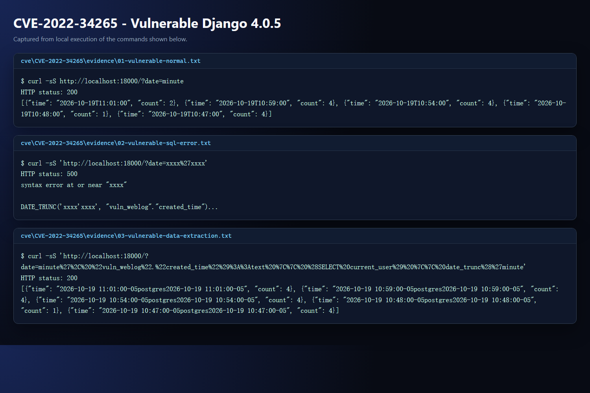
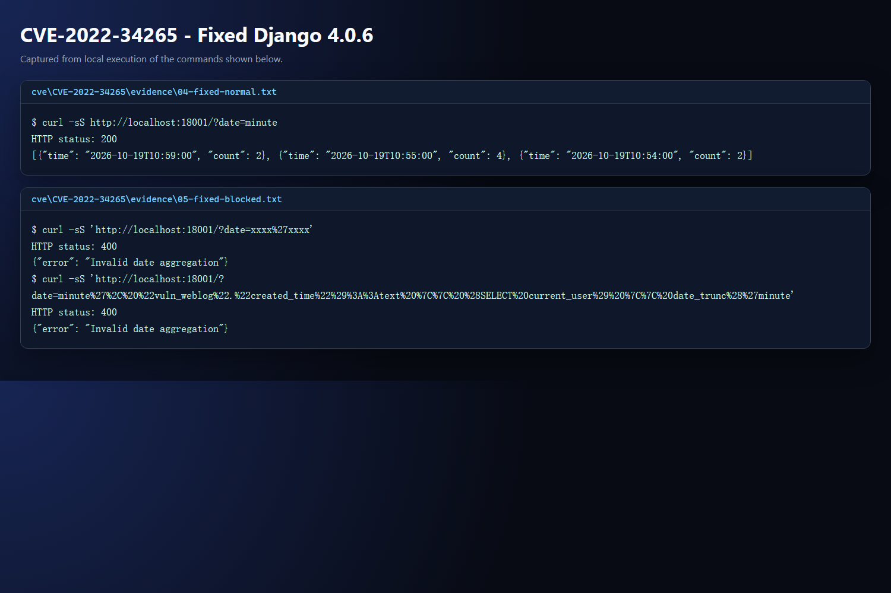

# HDU IS Lab 1 - Secure REST API, CI Security Scanning, and CVE Analysis

This repository implements Work 1 from the HDU IS laboratory manual:

- a secure REST API with authentication, SQLi protection, and XSS protection;
- a CI pipeline with SAST and SCA checks;
- a real vulnerable environment based on Vulhub;
- reproduction, root-cause analysis, remediation, and regression verification for **CVE-2022-34265**.

CVE-2022-34265 is not present in the user-provided exclusion list.

## Stack

- Node.js 24 and Express 5
- Built-in `node:sqlite` with prepared statements
- `bcryptjs` password hashing
- JWT access tokens (`HS256`, issuer/audience/expiry validation)
- `helmet` security headers and `express-rate-limit`
- Node test runner plus `supertest`
- ESLint with `eslint-plugin-security` (SAST)
- `npm audit` (SCA)
- GitHub Actions CI
- Docker Compose, Django 4.0.5/4.0.6, and PostgreSQL 13 for the CVE lab

## Repository Layout

```text
.
|-- .github/workflows/ci.yml        GitHub Actions CI
|-- src/                            secure API implementation
|-- test/                           API and security regression tests
|-- scripts/                        CI summary and evidence rendering
|-- docs/evidence/                  command outputs and screenshots
|-- cve/CVE-2022-34265/             vulnerable and fixed Django environments
|-- REPORT.md                       structured laboratory report
`-- package.json
```

## Run the API

PowerShell:

```powershell
$env:JWT_SECRET = "replace-with-at-least-32-random-characters"
$env:DATABASE_PATH = "data/app.db"
$env:PORT = "3000"
npm ci
npm start
```

The application refuses to start when `JWT_SECRET` is missing or shorter than 32 characters. Never commit the real secret; `.env` is ignored by Git.

If Docker Engine is installed inside Ubuntu WSL (as on this machine), run the CVE scripts from PowerShell with:

```powershell
wsl -d Ubuntu -- bash -lc "cd /path/to/repository/cve/CVE-2022-34265 && bash proof/reproduce.sh"
```

The educational seed account is:

```text
login:    alice
password: CorrectHorseBatteryStaple!42
```

This account exists only for the laboratory demonstration. A production system should provision accounts through an explicit administrative process and require a unique strong password.

## API

| Method | Endpoint | Authentication | Description |
| --- | --- | --- | --- |
| `GET` | `/health` | No | Service health check |
| `POST` | `/auth/login` | No | Validate credentials and issue a JWT |
| `GET` | `/api/data` | Bearer JWT | Return the posts visible to an authenticated user |
| `POST` | `/api/posts` | Bearer JWT | Create a post for the authenticated user |

### Login

```powershell
$login = Invoke-RestMethod `
  -Method Post `
  -Uri http://localhost:3000/auth/login `
  -ContentType "application/json" `
  -Body '{"login":"alice","password":"CorrectHorseBatteryStaple!42"}'

$token = $login.accessToken
```

### Read Protected Data

```powershell
Invoke-RestMethod `
  -Uri http://localhost:3000/api/data `
  -Headers @{ Authorization = "Bearer $token" }
```

Without a valid token, the endpoint returns HTTP 401:

```json
{"error":"Authentication required"}
```

### Create a Post

```powershell
Invoke-RestMethod `
  -Method Post `
  -Uri http://localhost:3000/api/posts `
  -Headers @{ Authorization = "Bearer $token" } `
  -ContentType "application/json" `
  -Body '{"title":"Lab note","body":"The API is running."}'
```

## Security Measures

### SQL Injection Protection

All database values are sent through SQLite prepared statements with `?` placeholders. User input is never concatenated into SQL text:

```js
const selectUserByLogin = db.prepare(
  'SELECT id, login, password_hash, display_name FROM users WHERE login = ?'
);
const user = selectUserByLogin.get(login);
```

The same pattern is used for post creation and lookup. Query identifiers are fixed in source code, not selected from request parameters. Login and post payloads are also length- and type-validated before they reach the database.

The test suite sends `' OR 1=1 --` as the login field and verifies that authentication still returns HTTP 401.

### XSS Protection

All user-controlled text returned by the API is escaped with `escape-html` in `src/security.js`. A stored title such as `<script>alert(1)</script>` is returned as:

```json
{"title":"&lt;script&gt;alert(1)&lt;/script&gt;"}
```

The response is declared as JSON, `helmet` sets `X-Content-Type-Options: nosniff`, and a restrictive Content Security Policy is enabled. Output escaping is intentionally applied as defense in depth for clients that incorrectly render response fields as HTML.

### Broken Authentication Protection

- Passwords are hashed with bcrypt (cost 12 by default; tests use a lower cost for speed).
- Password hashes never appear in API responses.
- A random dummy hash is compared when the account does not exist, reducing login timing differences.
- JWTs are signed with HS256 and include `sub`, `iss`, `aud`, and an expiry.
- Verification pins the HS256 algorithm and validates the issuer and audience.
- Protected endpoints also confirm that the token subject still maps to an existing user.
- Login attempts are rate limited.
- Failed logins return a generic message to avoid account enumeration.

### Additional Hardening

- Request body limit: 16 KiB.
- Generic server errors in production-facing responses; stack traces are not returned.
- `x-powered-by` is disabled.
- Security headers are supplied by `helmet`.
- The server fails closed when the JWT secret is missing or too short.

## Tests and Local CI Evidence

Run all checks:

```powershell
npm test
npm run lint
npm audit --audit-level=high
```

If `npm audit` reports `ECONNRESET` on a network with broken IPv6 routing, force IPv4 first for that command:

```powershell
$env:NODE_OPTIONS = "--dns-result-order=ipv4first"
npm audit --audit-level=high
```

Current results:

- 8 API and security regression tests pass.
- ESLint security scan: 0 errors, 0 warnings.
- `npm audit`: 0 vulnerabilities.

Evidence:

- [API test suite](docs/evidence/api-tests.png)
- [Authentication and protected data](docs/evidence/api-auth.png)
- [SQLi and stored XSS defenses](docs/evidence/api-security.png)
- [SAST and SCA scans](docs/evidence/ci-security.png)

## CI/CD Pipeline

`.github/workflows/ci.yml` runs on every push and pull request:

1. checkout the repository;
2. install the locked dependency tree with `npm ci`;
3. run API and security tests;
4. run SAST with ESLint and `eslint-plugin-security`;
5. run SCA with `npm audit --audit-level=high`;
6. upload JSON security reports as a workflow artifact;
7. write a compact SAST/SCA summary to the GitHub Actions job summary.

The workflow requires no repository secrets. The JWT secret used by tests is a test-only value inside the test file.

## Real CVE Analysis: CVE-2022-34265

### Vulnerability Summary

**CVE-2022-34265** is a SQL injection vulnerability in Django's `Trunc(kind)` and `Extract(lookup_name)` database functions. It affects Django versions before 4.0.6 and before 3.2.14. The vulnerable laboratory application passes the `date` query parameter directly into `Trunc`:

```python
date = request.GET.get("date", "minute")
WebLog.objects.annotate(time=Trunc("created_time", date))
```

The vulnerable environment uses Django 4.0.5 and PostgreSQL 13.

### Vulnerable Environment

```bash
cd cve/CVE-2022-34265
docker compose -f docker-compose.vulnerable.yml up -d
```

The application listens on `http://localhost:18000`. Port `18000` is used because port `8000` is already occupied by a local HDU service on the development machine.

### Reproduction

```bash
cd cve/CVE-2022-34265
bash proof/reproduce.sh
```

The script starts the vulnerable environment, sends a normal request, triggers a SQL error, and performs a controlled `current_user` extraction. The actual output is stored in `cve/CVE-2022-34265/evidence/`.

Key result from the controlled extraction:

```json
[{"time":"2026-10-19 11:01:00-05postgres2026-10-19 11:01:00-05","count":4}]
```

The value `postgres` is returned from the database by the injected `SELECT current_user` expression.



### Root Cause

In Django 4.0.5, `TruncBase.as_sql()` passes `self.kind` to the database backend without validating it:

```python
sql = connection.ops.datetime_trunc_sql(self.kind, inner_sql, tzname)
```

The PostgreSQL backend builds `DATE_TRUNC('...', ...)` from that value. The application supplies attacker-controlled text as `kind`, so a single quote breaks out of the SQL string literal and permits arbitrary SQL expression injection.

This is not a missing-escaping issue in the application alone: the framework API accepted an unvalidated SQL lookup/identifier and placed it into a SQL function call. The correct framework-level fix is to validate the allowed truncation/extraction names before SQL construction.

### Fix

The fixed environment is built by `cve/CVE-2022-34265/Dockerfile.fixed`:

```dockerfile
FROM vulhub/django:4.0.5
RUN pip install --no-cache-dir "Django==4.0.6"
```

Django 4.0.6 adds a server-side validation check before generating SQL:

```python
if not connection.ops.extract_trunc_lookup_pattern.fullmatch(self.kind):
    raise ValueError("Invalid kind: %s" % self.kind)
```

The application fix adds a second, independent allowlist for the public `date` parameter and disables DEBUG in the fixed deployment. Invalid values now return HTTP 400 instead of reaching the database:

```python
ALLOWED_TRUNC_KINDS = frozenset(
    {"minute", "hour", "day", "week", "month", "quarter", "year"}
)

if date not in ALLOWED_TRUNC_KINDS:
    return JsonResponse({"error": "Invalid date aggregation"}, status=400)
```

### Verification and Regression Test

```bash
cd cve/CVE-2022-34265
bash proof/verify-fix.sh
```

Results:

- normal request: HTTP 200 with the usual JSON aggregation;
- `date=xxxx'xxxx`: HTTP 400;
- `current_user` injection payload: HTTP 400;
- no SQL error or database user text in the fixed response;
- Django version inside the fixed container: 4.0.6.



Detailed CVE notes are in [cve/CVE-2022-34265/README.md](cve/CVE-2022-34265/README.md).

## Stop the CVE Environments

```bash
cd cve/CVE-2022-34265
docker compose -f docker-compose.vulnerable.yml down
docker compose -f docker-compose.fixed.yml down
```

## Report

The structured report with the title-page fields and submission checklist is in [REPORT.md](REPORT.md).
